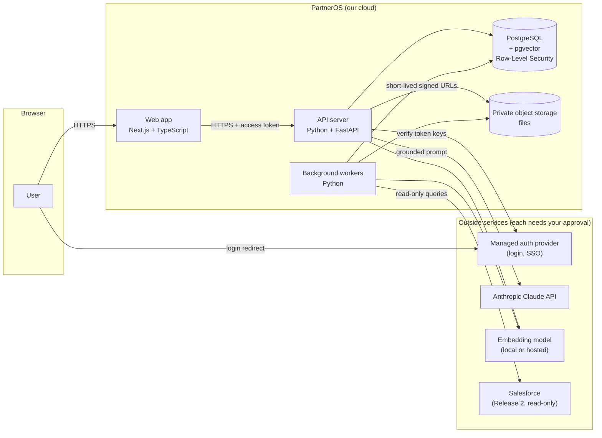
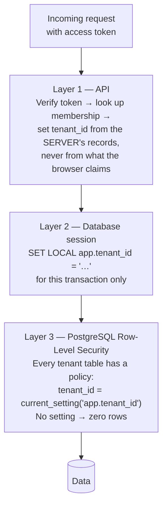
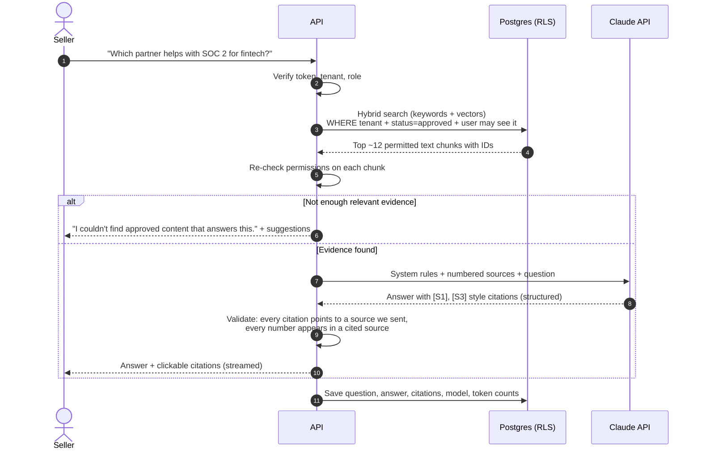
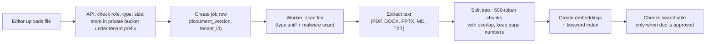

# 1. Product Architecture

**Status:** Proposed — awaiting founder approval
**Scope:** Release 1 (core platform + grounded AI) and Release 2 (read-only Salesforce)

---

## 1.1 What we are building, in one paragraph

PartnerOS is a website that partnership teams log into. Each customer company
("tenant") gets its own private space holding partner profiles, value
propositions, sales plays and approved content (PDFs, decks, docs). An AI
assistant answers questions using **only** the content the person asking is
allowed to see, and it shows where every statement came from. In Release 2 we
connect each tenant's Salesforce **read-only**, so the assistant and dashboards
can show real pipeline numbers — never invented ones.

## 1.2 The big picture



### The pieces, in plain English

| Piece | What it does | Why this choice |
|---|---|---|
| **Web app** (Next.js, TypeScript, Tailwind) | Everything the user sees and clicks. Holds no business rules that matter for security. | Your chosen stack; strong ecosystem; TypeScript catches mistakes early. |
| **API server** (FastAPI) | The single gatekeeper. Every read or write goes through it. It checks *who you are*, *which tenant you're in*, and *what your role allows* before touching data. | Python is the best ecosystem for AI/document work; FastAPI generates an OpenAPI spec automatically, so the API documents itself. |
| **Background workers** (Python, same codebase as API) | Slow jobs: extracting text from uploaded files, splitting it into chunks, creating embeddings, and (Release 2) syncing Salesforce. | Users shouldn't wait on a 30-second PDF parse. Sharing code with the API means one set of security rules. |
| **PostgreSQL + pgvector** | Stores all data **and** the "embeddings" (number fingerprints of text used for AI search). | One database instead of a separate vector database = one place to enforce tenant isolation, one backup, one thing to secure. |
| **Private object storage** (S3-compatible; MinIO locally) | Stores the original files. Never public. Users download through short-lived signed links issued *after* a permission check. | Databases are bad at big files; object storage is cheap and durable. |
| **Managed auth provider** | Handles passwords, MFA, "Sign in with Google/Microsoft", and enterprise SSO (SAML/OIDC). | Building login yourself is a classic security mistake. Enterprise buyers will demand SSO; a managed provider gives it to us. **Vendor choice needs your approval** (see §1.10). |
| **Claude API** | Writes answers from the content we retrieve. | Your chosen model provider. |
| **Embedding model** | Turns text into vectors for semantic search. Anthropic does not offer an embeddings endpoint, so we need a separate one. | Recommend a free, open-source model running inside our workers for development; decide on production later (see §1.10). |

## 1.3 How tenant isolation works (the most important section)

"Tenant isolation" means Company A can never see Company B's data — not through
a bug, not through a crafted URL, not through the AI. We enforce it in **three
independent layers**, so a bug in one layer is caught by the next.



1. **API layer.** The browser sends a signed access token. The API verifies the
   signature, finds the user, and looks up their membership in the tenant they
   selected. If they are not a member, the request stops (`404`, so we don't
   even confirm the tenant exists). The tenant ID used for everything after
   this point comes from our database, not from the request.
2. **Database session layer.** Each request runs in a database transaction that
   begins with `SET LOCAL app.tenant_id = '<id>'` and `SET LOCAL app.user_id`.
   `SET LOCAL` disappears when the transaction ends, so a pooled connection can
   never "remember" the previous request's tenant.
3. **PostgreSQL Row-Level Security (RLS).** Every table holding tenant data has
   `tenant_id` and an RLS policy. The API connects as a restricted database
   role (`partneros_app`) that **cannot** bypass RLS and does **not** own the
   tables. Even if a developer forgets a `WHERE tenant_id = …`, Postgres
   silently filters out other tenants' rows. If the tenant setting is missing,
   the policy matches nothing — it fails *closed*.

**Extra safety net — composite foreign keys.** Links between tables include the
tenant ID (e.g. a value proposition references `(tenant_id, partner_id)`), so the
database itself refuses to attach Tenant A's content to Tenant B's partner.

**Why not a separate database per tenant?** It is stronger isolation but much
more expensive and slower to operate (hundreds of databases to migrate, back up
and monitor). Shared tables + RLS is the industry-standard approach for B2B SaaS
at our stage. We keep the option open: a large enterprise customer could later
get a dedicated database with the same code.

## 1.4 Roles and permissions (RBAC)

Each person has one role **per tenant** (the same person could be an admin in
one tenant and a viewer in another).

| Role | Typical person | Can do |
|---|---|---|
| **Owner** | Customer's account owner | Everything an admin can, plus billing/tenant deletion and transferring ownership. At least one per tenant. |
| **Admin** | Head of partnerships, IT | Manage members, roles, groups, SSO settings, integrations; see audit log; everything an editor can. |
| **Editor** | Partner manager | Create/edit partners, value props, sales plays; upload documents; submit and approve content. |
| **Viewer** | Seller, account executive | Read approved content they have access to; use the AI assistant; give feedback. |

Full permission matrix: [03-api-spec.md §3.3](03-api-spec.md#33-permission-matrix).

Roles are checked **in the API on every endpoint** via one shared
`require_permission("partners:write")` helper — never in the web app alone (the
web app only hides buttons for convenience).

## 1.5 Document-level authorization

Some content is sensitive even inside a company (e.g. "Strategic pricing for
Partner X — leadership only"). So each document has:

- **Status:** `draft → in_review → approved → archived`. Only **approved**
  content is shown to viewers or used by the AI.
- **Visibility:** `tenant` (everyone in the tenant) or `restricted` (only listed
  groups and/or roles).

**The rule that matters:** permissions are applied **before** retrieval, inside
the same SQL query that does the vector search. The AI never receives text the
user couldn't open themselves. After the query we re-check each result in
Python (belt *and* braces) before anything goes to Claude.

## 1.6 How the AI assistant works (Retrieval-Augmented Generation)



**Rules that prevent made-up answers:**

1. **Grounding only.** The system prompt tells Claude to answer *only* from the
   numbered sources provided and to say "not found" otherwise.
2. **Refuse early.** If search returns nothing above a relevance threshold, we
   don't call Claude at all — we answer "no approved content found". Cheaper and
   impossible to hallucinate.
3. **Citation validation.** Claude returns structured output listing which
   source IDs support each sentence. The server drops any citation ID we didn't
   send. If an answer has no valid citations, we don't show it as an answer.
4. **Number check.** Any money amount, percentage or count in the answer must
   appear verbatim (after normalisation) in a cited source; otherwise the answer
   is flagged and the number is removed or the answer is replaced with a
   "couldn't verify" message. Revenue figures in Release 2 come **only** from
   synced Salesforce fields, rendered by our code — not typed by the model.
5. **Prompt injection defence.** Uploaded documents might contain text like
   "ignore your instructions". Sources are wrapped in clearly marked data
   blocks, the model has **no tools that change anything**, and it can only see
   data the user can already see — so the worst case is a bad answer, not a
   data leak or an action.
6. **Evaluation set.** We keep a fixed set of synthetic questions with known
   right answers (and known "should refuse" questions) and run it in CI when
   prompts or retrieval change.

**Partner recommendations** use the same pipeline: retrieve permitted partner
profiles, value props and plays → Claude ranks up to N partners, giving reasons
that each cite a source. No source, no recommendation.

**Model choice:** configurable per environment. Default plan: a Sonnet-class
model for answers and a Haiku-class model for cheap tasks (titles,
query rewriting). Exact model IDs live in config, not code.

## 1.7 Document ingestion pipeline



- Jobs carry `tenant_id`; the worker sets the same `app.tenant_id` database
  setting before touching data, so RLS protects workers too.
- **Job queue:** a Postgres table with `SELECT … FOR UPDATE SKIP LOCKED`. This
  avoids running Redis/RabbitMQ at our stage. We can swap in a dedicated queue
  later behind the same interface.
- Re-uploading creates a **new version**; old chunks are replaced atomically
  when the new version is approved, so the AI never cites a half-processed file.

## 1.8 Release 2 — read-only Salesforce

- **Connection:** an admin clicks "Connect Salesforce" → Salesforce's OAuth
  login → we receive tokens. Tokens are encrypted before storage (envelope
  encryption with a cloud key-management service in production; a local key in
  development).
- **Read-only, enforced three ways:**
  1. Our Salesforce client code only implements *read* calls (SOQL query,
     describe). There is no update/create/delete method to call by mistake.
  2. An allow-list of objects and fields (Account, Opportunity, Partner-related
     fields, etc.). Anything else is rejected before the request is sent.
  3. We instruct customers to connect with a Salesforce integration user whose
     profile/permission set is read-only. (Salesforce's OAuth `api` scope is
     not read-only by itself, so we don't rely on scopes alone.)
- **Sync, don't query live:** a worker copies the allowed records into our
  tenant-scoped tables on a schedule (and on demand). Dashboards and the AI read
  our copy, which is faster, cheaper and keeps the same RLS protection.
- **Numbers:** pipeline totals are computed by SQL from synced records and
  displayed with "as of <sync time>". The AI may *reference* these computed
  figures as a citable source, but cannot produce its own.

## 1.9 Repository layout (proposed monorepo)

```
partneros/
├── apps/
│   ├── web/            Next.js app (TypeScript, Tailwind)
│   └── api/            FastAPI app + workers (one Python package)
│       ├── partneros/
│       │   ├── api/        HTTP routes
│       │   ├── auth/       token verification, RBAC helpers
│       │   ├── db/         models, session, tenant context
│       │   ├── services/   business logic
│       │   ├── ai/         retrieval, prompts, citation validation
│       │   ├── ingest/     extraction, chunking, embeddings
│       │   ├── workers/    job runner
│       │   └── integrations/salesforce/  (Release 2)
│       ├── migrations/     Alembic migrations
│       └── tests/
├── fixtures/           Synthetic demo data (fictional companies only)
├── infra/
│   └── docker/         Dockerfiles, compose files, dev auth stub
├── docs/               These documents + runbooks + ADRs
├── .github/workflows/  CI
└── Makefile            One-word commands: make up, make test, …
```

## 1.10 Decisions that need your approval

| # | Decision | My recommendation | When needed |
|---|---|---|---|
| D1 | **Where the code lives.** This repo (`calcalculate`) is a calorie-tracker site. | Create a new private repo `partneros` and move this `partneros/` folder there. Until then, we work in this folder so nothing else is affected. | Before Milestone 1 |
| D2 | **Auth provider** (paid, external account). Candidates: WorkOS, Auth0, Clerk, AWS Cognito, or self-hosted Keycloak. | Milestone 1 uses a **local fake login** (no account needed). Choose a provider before Milestone 4; WorkOS or Auth0 are strongest for enterprise SSO. | Milestone 4 |
| D3 | **Embedding model.** Hosted (e.g. Voyage AI — paid) vs open-source running in our worker (free, slightly lower quality). | Open-source locally for development; benchmark both on our evaluation set before choosing for production. | Milestone 5 |
| D4 | **Cloud/hosting** (AWS, GCP, Azure, or a PaaS). | Defer. Everything runs in Docker locally until we have something worth deploying. | Before first deploy |
| D5 | **Anthropic account & data terms.** Customer content will be sent to Anthropic. | You create the account; we review data-retention terms before any real customer data. Development uses synthetic data only. | Milestone 5 |

## 1.11 Non-functional targets (initial)

| Area | Target |
|---|---|
| Availability | 99.5% to start; 99.9% once we have paying customers |
| API latency | p95 < 300 ms for normal reads; AI answers start streaming < 3 s |
| Data protection | Encryption in transit (TLS 1.2+) and at rest; daily backups, 30-day retention, tested restores |
| Audit | Security-relevant actions logged, append-only, 1-year retention |
| Accessibility | WCAG 2.1 AA for core screens |
| Browser support | Last 2 versions of Chrome, Edge, Safari, Firefox |
| Observability | Structured JSON logs with request ID + tenant ID (no document text, no tokens); metrics; error tracking (vendor choice needs approval) |
