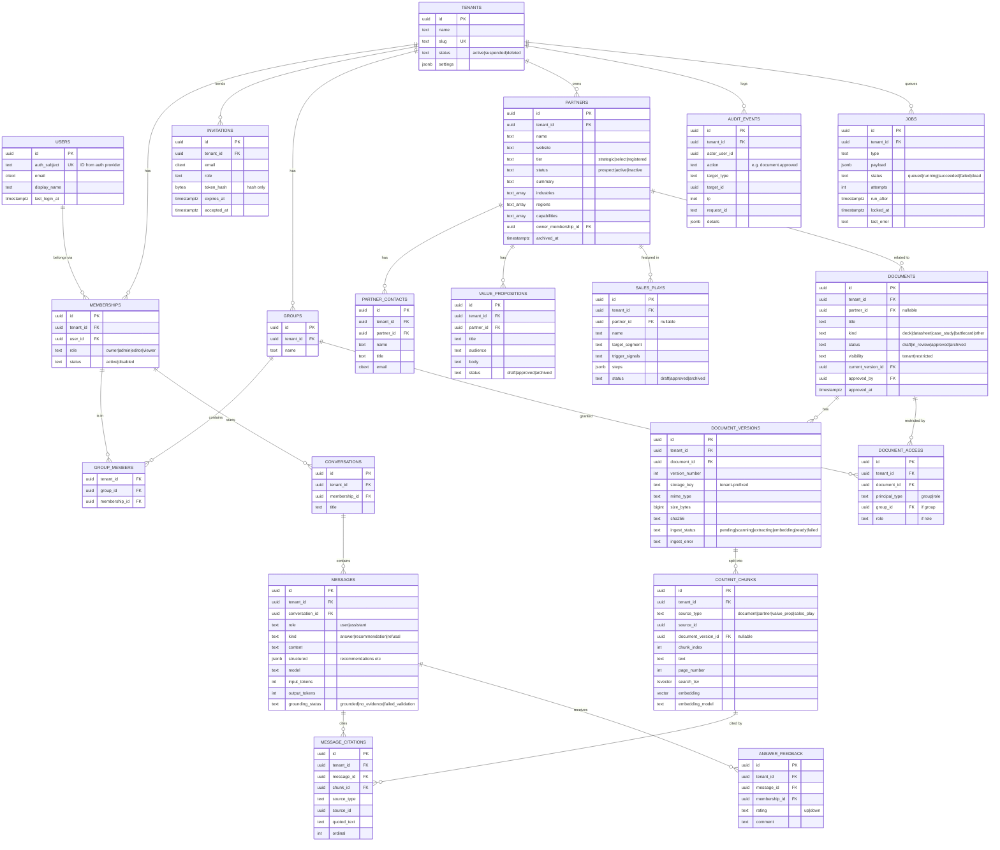
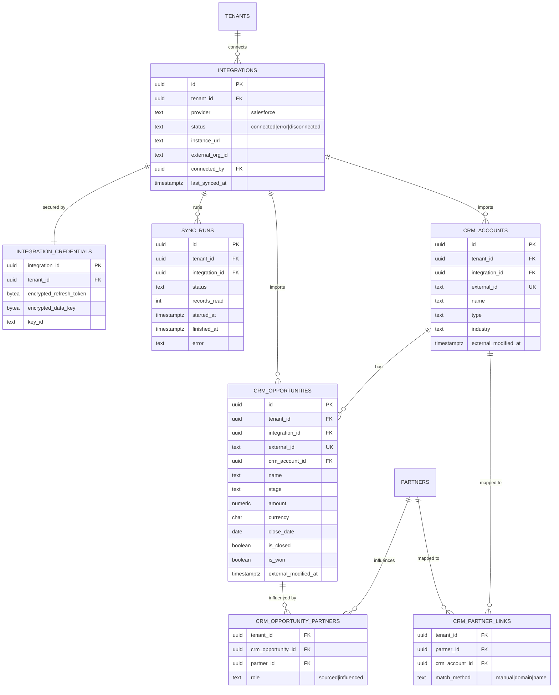

# 2. Database Entity Relationship Design

**Status:** Proposed — awaiting founder approval
**Database:** PostgreSQL 17 with the `pgvector` and `pgcrypto` extensions

---

## 2.1 Conventions (rules every table follows)

| Rule | Why |
|---|---|
| Primary keys are UUIDs (`id uuid default gen_random_uuid()`). | IDs can't be guessed or counted ("we have 42 customers"). |
| Every tenant-owned table has `tenant_id uuid not null`. | Required for Row-Level Security. |
| Every tenant-owned table has RLS **enabled and forced**. | Isolation is enforced by the database, not just the app. |
| Foreign keys between tenant tables include `tenant_id`, e.g. `foreign key (tenant_id, partner_id) references partners (tenant_id, id)`. | The database refuses cross-tenant links. Each table has `unique (tenant_id, id)` to make this possible. |
| `created_at`, `updated_at` (timestamptz, UTC) on every table; `created_by` where a person acts. | Debugging and audit. |
| Soft delete (`archived_at`) for business content; hard delete for personal data on request. | Recover mistakes; still honour deletion requests. |
| Enumerations are Postgres `text` + `check` constraints (not native enums). | Easier to change in migrations. |
| Money is `numeric(18,2)` + `currency char(3)`. Never floats. | Floats round money incorrectly. |
| All schema changes go through numbered **Alembic** migrations, reviewed in PRs. | Repeatable, reversible database history. |

## 2.2 Diagram — Release 1



## 2.3 Diagram — Release 2 additions (Salesforce, read-only)



## 2.4 Notes on the trickier tables

### `users` and `memberships` — why two tables?
A person (user) is global — the same email can belong to several tenants (common
for consultants). What they can *do* lives on the **membership**, which is
tenant-scoped. `users` itself has a special RLS policy: you can see a user row
only if it's you, or the user is a member of your current tenant.

### `content_chunks` — the AI search table
- One row per ~500-token slice of text, from documents **and** from structured
  records (partner profiles, value props, sales plays are turned into text so
  the AI can search them too).
- `embedding vector(N)`: `N` depends on the embedding model (decision D3). We
  store `embedding_model` so we can re-embed safely when switching models.
- `search_tsv` powers keyword search; we combine keyword + vector ("hybrid
  search") because exact names like "SOC 2" or product SKUs are matched better
  by keywords.
- Index: HNSW index on `embedding` (cosine), GIN index on `search_tsv`, and a
  B-tree on `(tenant_id, source_type, source_id)`.
- **Permissions are NOT copied onto chunks.** They're joined at query time from
  `documents` / `document_access` / record status. Copying would risk stale
  permissions — e.g. a document restricted today but still searchable via old
  chunk rows.

### Retrieval permission filter (sketch)
```sql
-- RLS already limits rows to the current tenant.
select c.*
from content_chunks c
left join documents d on c.source_type = 'document' and d.id = c.source_id
where
  (
    c.source_type <> 'document'
    and exists (/* the partner / value prop / play is approved and not archived */)
  )
  or (
    d.status = 'approved'
    and c.document_version_id = d.current_version_id
    and (
      d.visibility = 'tenant'
      or exists (
        select 1 from document_access a
        where a.document_id = d.id
          and (
            (a.principal_type = 'role'  and a.role = :caller_role)
            or (a.principal_type = 'group' and a.group_id = any(:caller_group_ids))
          )
      )
      or :caller_role in ('owner', 'admin')
    )
  )
order by c.embedding <=> :query_embedding
limit 50;
```
The exact rules are covered by automated tests (see backlog item AI-2).

### `audit_events` — append-only
The application database role has `INSERT` and `SELECT` only on this table —
no `UPDATE` or `DELETE` — so even an application bug can't erase history.

### `integration_credentials` — Release 2
Salesforce refresh tokens are encrypted with a per-record data key, and that
data key is itself encrypted by a master key held in a key-management service
("envelope encryption"). A database dump alone can't reveal tokens.

## 2.5 Database roles

| Role | Used by | Powers |
|---|---|---|
| `partneros_owner` | Migrations only (CI/deploy step) | Owns tables, can change schema. Never used by the running app. |
| `partneros_app` | API and workers | Read/write data, **subject to RLS**. No `BYPASSRLS`, not a table owner, cannot change schema. |
| `partneros_readonly` | Support/analytics (later) | `SELECT` only, still subject to RLS. |

## 2.6 Example RLS setup (what a migration will contain)

```sql
alter table partners enable row level security;
alter table partners force row level security;

create policy tenant_isolation on partners
  using      (tenant_id = nullif(current_setting('app.tenant_id', true), '')::uuid)
  with check (tenant_id = nullif(current_setting('app.tenant_id', true), '')::uuid);
```
- `current_setting(..., true)` returns null when unset → the comparison is
  never true → **zero rows**. Forgetting to set the tenant fails safely.
- `with check` stops writes into another tenant, not just reads.

## 2.7 Synthetic fixtures

Seed data uses only invented companies and people, for example:

- **Tenant "Orbitly"** (a fictional SaaS vendor) with partners *Bluefin Data
  Co.*, *Quillstone Security*, *Harborlight Consulting*.
- **Tenant "Fernhill Software"** with a *different* set of partners — including
  one also called "Quillstone Security", so tests prove same-named records in
  two tenants never mix.
- Documents are short generated Markdown/PDF files with obviously fake facts
  ("Quillstone reduces audit prep time by 37% (synthetic)").
- People use `example.com` emails (reserved for documentation by RFC 2606).
