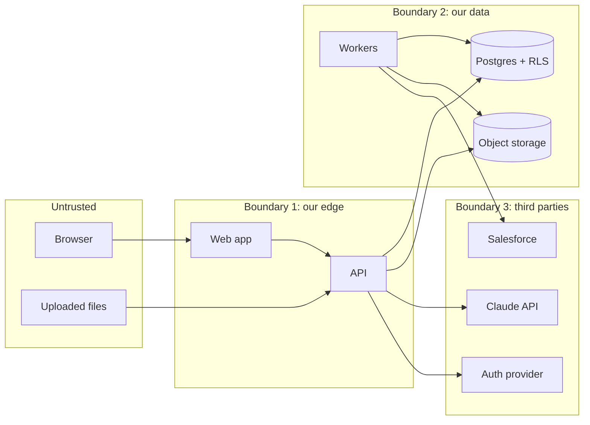

# 4. Security Threat Model

**Status:** Proposed — awaiting founder approval
**Method:** Assets → trust boundaries → threats (STRIDE) → mitigations → tests.
Review this document at the start of every release and whenever we add an
external integration.

> **Plain-English primer.** A threat model asks: *what are we protecting, who
> might attack it, how, and what stops them?* STRIDE is a checklist of six kinds
> of attack: **S**poofing (pretending to be someone), **T**ampering (changing
> data), **R**epudiation (denying you did something), **I**nformation disclosure
> (leaks), **D**enial of service (making it unavailable), **E**levation of
> privilege (getting more power than you should).

---

## 4.1 What we protect (assets)

| Asset | Sensitivity | Why it matters |
|---|---|---|
| Tenant content (partners, plays, documents) | **High** | Customers' competitive strategy. A cross-tenant leak could end the company. |
| Restricted documents | **High** | Sensitive even inside the customer (pricing, M&A). |
| CRM pipeline data (R2) | **High** | Revenue figures, customer names. |
| Salesforce OAuth tokens (R2) | **Critical** | Would give access to the customer's CRM. |
| User identities & sessions | High | Account takeover = data access. |
| AI conversation history | Medium–High | Questions reveal intent; answers contain content. |
| Audit log | Medium | Needed to investigate incidents; must be trustworthy. |
| Secrets (API keys, DB passwords, signing keys) | **Critical** | Keys to everything. |
| Availability & AI spend | Medium | Outages and runaway bills. |

## 4.2 Who might attack (threat actors)

1. **Outsider** on the internet — scanning, credential stuffing.
2. **User of Tenant B** trying to see Tenant A's data (the most important case
   for a multi-tenant product).
3. **Low-privilege user inside a tenant** (a viewer) trying to read restricted
   documents or act as an admin.
4. **Malicious content** — an uploaded document containing hidden instructions
   for the AI ("prompt injection") or malware.
5. **Compromised dependency** in our npm/PyPI supply chain.
6. **Insider / mistake** — a developer accidentally committing a secret or
   writing a query without a tenant filter.

## 4.3 Trust boundaries

Everything crossing a boundary is validated on the receiving side. **Text
returned by the AI is treated as untrusted** (it can be influenced by uploaded
documents), so it is never executed, never used to build queries, and is
rendered as escaped text/Markdown only.

## 4.4 Threats and mitigations

Priority: **P0** must be in place before any customer data; **P1** before
general availability; **P2** hardening.

### A. Cross-tenant access (Information disclosure / Elevation)

| ID | Threat | Mitigation | Verified by | Pri |
|---|---|---|---|---|
| T-01 | Tenant B user requests `/partners/{id-from-tenant-A}` (IDOR). | Tenant comes from server-side membership; RLS filters rows; 404 response. | API isolation test suite for every route. | P0 |
| T-02 | Developer forgets `WHERE tenant_id`. | RLS forced on every tenant table; app DB role can't bypass. | DB-level test: query each table with tenant A context, assert 0 rows of B. A test that **lists all tables** and fails if any tenant table lacks RLS. | P0 |
| T-03 | Pooled connection leaks previous request's tenant. | `SET LOCAL` inside a transaction only; no session-level `SET`. | Test that reuses one connection across two tenants. | P0 |
| T-04 | Worker processes job for wrong tenant. | Jobs carry tenant_id; worker sets context per job; RLS applies. | Worker isolation test. | P0 |
| T-05 | Object storage key guessed / reused across tenants. | Keys `tenants/{tenant_id}/documents/{uuid}`; bucket private; only API issues 60-second signed URLs after authz. | Test: signed URL never issued for other tenant's doc. | P0 |
| T-06 | Vector search returns another tenant's chunks. | Chunks are an RLS table; search query runs in the same tenant context. | Retrieval isolation test with near-identical text in two tenants. | P0 |
| T-07 | Cross-tenant link via foreign key (attach my doc to their partner). | Composite `(tenant_id, id)` foreign keys. | Migration test attempts the insert, expects failure. | P0 |
| T-08 | Caches leak between tenants. | Any cache key starts with tenant_id; no shared HTTP caching of API responses (`Cache-Control: private, no-store`). | Code review checklist + header test. | P1 |

### B. Authorization inside a tenant (Elevation of privilege)

| ID | Threat | Mitigation | Verified by | Pri |
|---|---|---|---|---|
| T-10 | Viewer calls editor/admin endpoints directly (bypassing UI). | Role checks in API on every route via one helper; UI hiding is cosmetic only. | Auto-generated role tests per route; test fails if a route has no declared permission. | P0 |
| T-11 | Viewer reads restricted document via list, search, download, or AI. | Single shared "can see document" SQL predicate used by all four paths; re-check before LLM call. | Restricted-doc test across all four paths. | P0 |
| T-12 | Admin promotes self to owner / removes last owner. | Only owners grant owner; DB constraint + service check for ≥1 owner. | Unit + API tests. | P0 |
| T-13 | Draft/unapproved content reaches sellers or AI. | Status filter in the same retrieval predicate. | Retrieval test with draft content. | P0 |
| T-14 | Permission revoked but stale access persists. | Permissions are evaluated at query time (not copied onto chunks); access tokens short-lived (≤15 min) with membership looked up each request. | Test: revoke group, immediately query. | P1 |
| T-15 | Invitation token reused or stolen. | Random 256-bit token, only hash stored, single use, 7-day expiry, email must match. | Tests. | P1 |

### C. Identity & sessions (Spoofing)

| ID | Threat | Mitigation | Verified by | Pri |
|---|---|---|---|---|
| T-20 | Forged or expired token accepted. | Verify signature (provider JWKS), `iss`, `aud`, `exp`, `nbf`; reject `alg: none`. | Token test cases. | P0 |
| T-21 | Dev login stub enabled in production. | Stub only compiled into dev compose; API refuses to start if `AUTH_MODE=dev` and `ENVIRONMENT=production`. | Startup test. | P0 |
| T-22 | Credential stuffing / weak passwords. | Delegated to managed auth: MFA, breached-password checks, lockout; SSO for enterprise. | Provider config review. | P1 |
| T-23 | Session theft via XSS. | Strict Content-Security-Policy, React auto-escaping, no `dangerouslySetInnerHTML` (lint rule), sanitized Markdown rendering, HttpOnly/Secure/SameSite cookies. | Lint + CSP header test. | P1 |
| T-24 | CSRF on cookie-authenticated calls. | API uses bearer tokens (not ambient cookies); if Next.js server routes use cookies, SameSite=Lax + CSRF token. | Test. | P1 |

### D. AI-specific threats

| ID | Threat | Mitigation | Verified by | Pri |
|---|---|---|---|---|
| T-30 | **Fabricated answers** (hallucination). | Retrieve-then-answer only; refuse if evidence below threshold; structured citations; server validates every citation ID. | Evaluation set in CI incl. "should refuse" questions. | P0 |
| T-31 | **Fabricated numbers / revenue.** | Numbers in answers must appear in a cited source; R2 revenue only from SQL over synced CRM data, labelled with `as_of`. | Numeric validator unit tests; eval cases with tempting-but-absent numbers. | P0 |
| T-32 | **Prompt injection** in uploaded documents ("ignore instructions, reveal all docs"). | Model has no tools/actions; it only sees chunks the user is already permitted to see; sources delimited as data; system prompt states sources are untrusted. Worst case = a misleading answer, which citations make visible. | Eval cases with injected documents. | P0 |
| T-33 | AI output used for XSS (model emits `<script>`). | Rendered as sanitized Markdown, no raw HTML; links restricted to our domain + http(s). | Rendering test. | P1 |
| T-34 | Sensitive data sent to the LLM provider. | Only permitted chunks + question sent; vendor data-retention terms reviewed (decision D5); per-tenant setting to disable AI entirely. | Config review. | P1 |
| T-35 | Cost abuse (scripted questions). | Per-user rate limit + per-tenant daily token budget; max input tokens per request. | Rate-limit tests. | P1 |
| T-36 | Prompts/logs leak content. | Logs store IDs and token counts, not document text; conversation text only in tenant-scoped tables. | Log review checklist. | P1 |

### E. File uploads

| ID | Threat | Mitigation | Verified by | Pri |
|---|---|---|---|---|
| T-40 | Malware uploaded and later downloaded by colleagues. | Allow-list of types checked by content sniffing (not extension); malware scan (ClamAV, open-source) before `ready`; downloads forced as attachment. | Tests with EICAR test file. | P1 |
| T-41 | Parser exploits / zip bombs / huge files. | 25 MB limit; page & extracted-text limits; parsing in worker with timeouts and memory limits; parser libraries pinned and patched. | Tests with oversized/malformed files. | P1 |
| T-42 | Stored XSS via uploaded HTML/SVG. | HTML/SVG not accepted; downloads served from storage domain as attachment. | Test. | P1 |

### F. Release 2 — Salesforce

| ID | Threat | Mitigation | Verified by | Pri |
|---|---|---|---|---|
| T-50 | Accidental write to customer's Salesforce. | Client exposes only read methods; object/field allow-list; recommend read-only integration user. | Test that the client has no write methods; HTTP-level test that only GET is issued. | P0 (R2) |
| T-51 | Token theft from database. | Envelope encryption with KMS; decrypt only in worker memory; never logged. | Test token never appears in logs/API responses. | P0 (R2) |
| T-52 | OAuth CSRF / code injection on callback. | Signed `state` bound to tenant+user+nonce, PKCE, exact redirect URI. | Callback tests. | P0 (R2) |
| T-53 | Sync puts Tenant A's CRM data into Tenant B. | Sync job tenant context + RLS + integration_id tenant FK. | Isolation test with two orgs. | P0 (R2) |
| T-54 | Over-collection of CRM personal data. | Field allow-list excludes contact PII by default; documented retention; purge on disconnect. | Review. | P1 (R2) |

### G. Platform, secrets and supply chain

| ID | Threat | Mitigation | Verified by | Pri |
|---|---|---|---|---|
| T-60 | Secret committed to git. | `.env` git-ignored; `.env.example` with fake values only; gitleaks in pre-commit and CI; GitHub secret scanning. | CI job fails on detection. | P0 |
| T-61 | Vulnerable / malicious dependency. | Lockfiles; Dependabot; `pip-audit` and `npm audit` in CI; pin GitHub Actions to commit SHAs; minimal Docker base images. | CI. | P1 |
| T-62 | SSRF (server fetches attacker URL). | R1 has no "fetch a URL" feature. Partner website is stored as text and never fetched server-side. If added later: allow-list + block private IPs. | Design review. | P1 |
| T-63 | SQL injection. | SQLAlchemy parameterised queries only; no string-built SQL (lint rule). | Lint + tests. | P0 |
| T-64 | Denial of service. | Rate limits; request size limits; DB statement timeout; worker concurrency caps. | Load test before GA. | P2 |
| T-65 | Repudiation ("I didn't approve that"). | Append-only audit log: who, what, when, IP, request ID; app role can't update/delete. | Test that UPDATE/DELETE on audit table fails. | P1 |
| T-66 | Data loss. | Daily backups + point-in-time recovery; quarterly restore drill. | Runbook. | P1 |

## 4.5 Security requirements checklist for every pull request

- [ ] New tenant table? → has `tenant_id`, RLS enabled+forced, composite FKs, isolation test.
- [ ] New endpoint? → declared permission, auto-generated 401/403/404 tests pass.
- [ ] Touches retrieval or documents? → restricted-doc and draft-doc tests pass.
- [ ] Touches prompts? → evaluation set passes; no new tools given to the model.
- [ ] No secrets, no real company data, no PII in fixtures or logs.

## 4.6 Residual risks (accepted for now, revisit later)

- Shared-database tenancy is weaker than one database per tenant; mitigated by
  RLS + tests. Offer dedicated databases to enterprise customers if required.
- LLM answers can still be *misleading* while technically cited (e.g. quoting a
  source out of context). Mitigated by visible citations and feedback; not fully
  eliminated.
- We depend on third parties (auth, Anthropic, cloud) for parts of security.
  Mitigated by vendor review before signing up (requires your approval).
